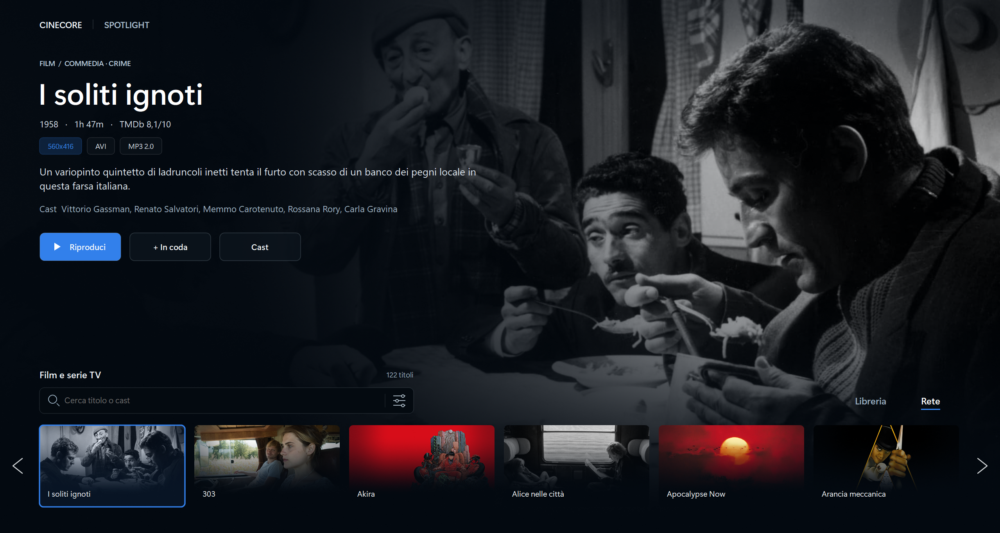
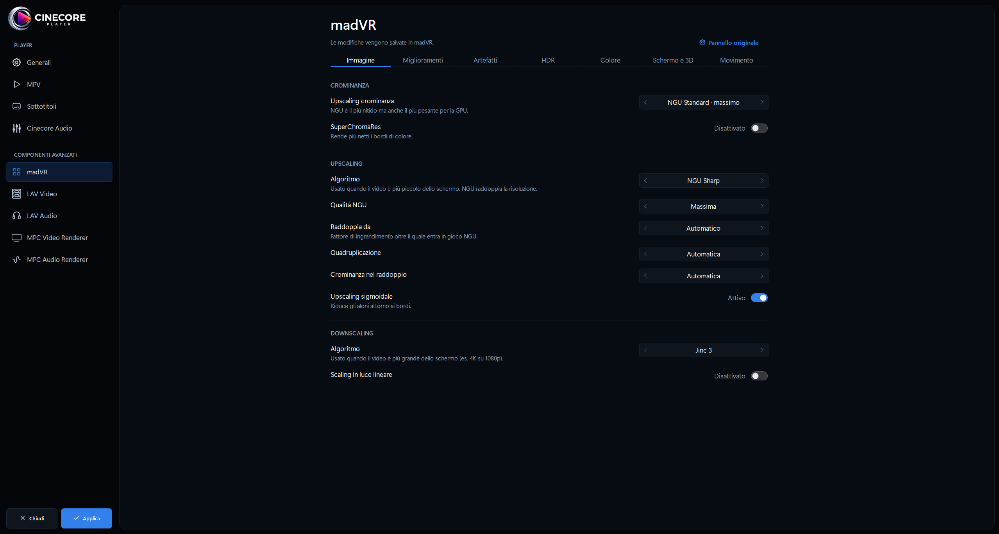
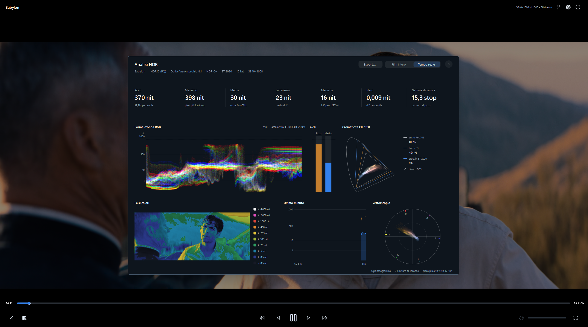
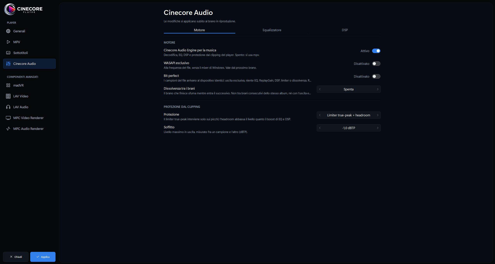
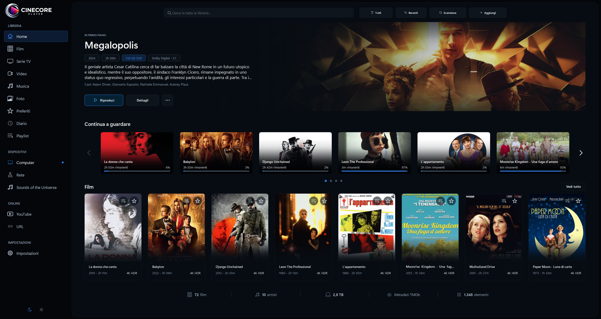
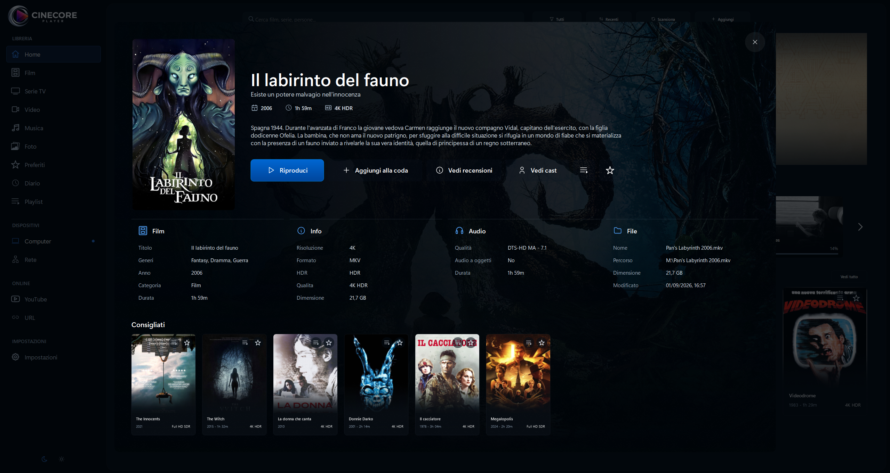
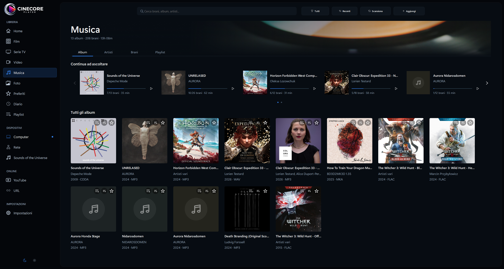
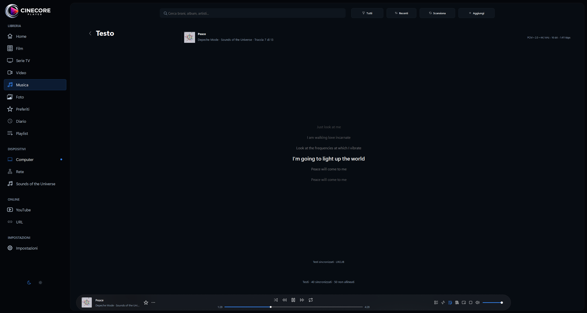
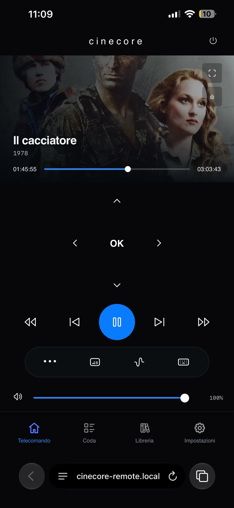

# 🎬 Cinecore Player 2026



[](https://polyformproject.org/licenses/noncommercial/1.0.0)
[](https://dotnet.microsoft.com/)
[](https://avaloniaui.net/)
[](#%EF%B8%8F-system-requirements)
[](#%EF%B8%8F-system-requirements)
[-yellow)](https://github.com/CinecorePlayer/CinecorePlayer/releases)
[-yellow)](https://github.com/CinecorePlayer/CinecorePlayer/releases)
[](#-status)
[](https://github.com/CinecorePlayer/CinecorePlayer/releases)
[](https://github.com/CinecorePlayer/CinecorePlayer)
[](#-languages)

Cinecore Player is a **free**, **source-available** and **non-commercial** media player for **Windows** and **macOS**, built in **C# / .NET 9.0** with an **Avalonia** interface, focused on high-quality local playback, home-cinema use and a modern media-center experience.

It combines **libmpv** with the DirectShow chain of **madVR**, **MPC Video Renderer (MPCVR)** and **LAV Filters**, with DVDs with their menus, Blu-ray / ISO playback, **audio CDs**, HDR analysis, a TMDb-powered library, native **Jellyfin** and **Emby** clients, its own **audio engine for music** with gapless playback and Automix, subtitle download and re-timing, Trakt, a phone remote, home automations and Cinema Mode.

---

## 🚧 Status

Two betas are coming soon, together:

- **Windows · Beta 4 (0.4.0)**, tag `beta-v0.4.0-Avalonia-Windows`. Cinecore Player moves to **Avalonia**: Home, the library, Spotlight, title and album pages and the settings are rebuilt, with a new library HUD, Automix and a manual transition editor. Moving between pages and using the playback controls is substantially faster than in the Beta 3.6 interface.
- **macOS · Beta 1 macOS (0.1.0)**, tag `beta-v0.1.0-Avalonia-MacOs`. The first native Mac version, for **Apple Silicon**, with the same Avalonia interface and the same features as Windows. mpv plays natively; **madVR** and **MPC Video Renderer** run through Wine for ARM64 in an optional engine that the app downloads on request: stable, but not as efficient as mpv.

Both are **betas**: everything described here works in everyday use, but they need more testing on other GPUs, displays, audio devices and networks, and parts of the interface may still change.

Tested so far on: NVIDIA RTX 3080, Intel Iris iGPU, AMD R5 220 (Windows); MacBook Air M4 (macOS).

---

## ✨ What's New

### On both platforms

- **Avalonia interface**: Home, the library, Spotlight, title and album pages and the settings rebuilt; a top bar with the sections and a search that opens from its icon, a full-width **Home hero** that rotates through your titles, carousels with the arrows in the margins, poster cards with the title under the picture
- **New library HUD**, modern and clean, and much faster page changes and playback controls than in Beta 3.6
- **New playback overlay**: timeline with previews, chapters, volume, ±10 s, cast, streaming quality and Skip Intro / next episode, plus the Info panel with the film and the live data of the renderer
- **Photos redesigned**: real glass controls over the photo, a filmstrip with zoom next to it, Info panel with camera, exposure and place (opens in Maps), favourites, slideshow, share, copy, set as desktop picture, print, open with and the Recycle Bin / Trash
- **New photo editor**: 14 adjustments as in Photos on the iPhone (exposure, brilliance, highlights, shadows, contrast, brightness, black point, saturation, vibrance, warmth, tint, sharpness, definition, vignette) on a ruler, **Enhance** that corrects only what is needed, **16 filters** with live previews, crop with rotation and flip, drawing (pen, highlighter, line, arrow, rectangle, ellipse, text, pixelate, eraser, eyedropper, any colour). Closing asks whether to save a copy or discard; the original is never changed
- **Trakt page "Recommended for you"**: a rotating hero, "To catch up" titles, a "See all" grid, and on every title *Open*, *Open on Trakt*, *Mark as watched* and *Not interested*
- **Automix**: the Cinecore Audio Engine uses tempo, beat grids, phrase boundaries and vocal activity to choose the cue points, the duration and the style of each transition
- **Tempo sync**: when enabled, the incoming track follows the outgoing track's tempo during the mix, then gradually returns to its own
- **Manual mix editor**: the full signal and the bass waveform of both tracks with beat markers; drag the tracks to set the cue points, resize the overlap, start from a preset or adjust volume, EQ, filter curves and effects, preview either track or the transition, and save it. A saved transition is used every time the same two tracks play in that order, and takes priority over Automix
- **Music**: full-screen track view and **mini player**
- **HDR analysis**: the full-film measurement runs only on its own tab, so the real-time view keeps all the speed
- **Cinema Mode** before the film, **WLED** lights, **home automations**, network **receiver control** with the volume safety rules
- **Spanish** next to English and Italian everywhere, TMDb data in the chosen language

### macOS only

- **Liquid Glass** (macOS 26 and later) for the music bar, the queue, the menus and the photo controls; real blur on earlier versions
- **mpv native** with VideoToolbox decoding, HDR on the Mac display (EDR) and automatic refresh-rate switching (also 23.976 / 24 Hz on an external display)
- **madVR and MPC Video Renderer on the Mac** through the downloadable Windows engine, presented at the exact vsync of the screen the film is on
- **Bitstream** of Dolby / DTS formats, also through HDMI adapters that only declare PCM (the format is carried inside PCM, tested format by format)
- Media keys and *Now Playing* of macOS, *Open at login*, Share sheet, Trash, Finder and Maps integration
- Updates from GitHub Releases with SHA-256 check, like on Windows

---

## 📥 Download

### Windows

Download the installer from the release **Cinecore Player Beta 4 (0.4.0)**, tag `beta-v0.4.0-Avalonia-Windows`, on the [Releases page](https://github.com/CinecorePlayer/CinecorePlayer/releases), and run it.

The installer:

- runs in English or Italian and follows the Windows light or dark theme;
- includes Cinecore, the .NET runtime, FFmpeg, libmpv, yt-dlp and libaacs / libbdplus, so nothing else has to be installed first;
- lets you select the optional components one by one: LAV Filters, MPC Audio Decoder, MPC Audio Renderer, madVR, MPC Video Renderer and XySubFilter;
- installs over a previous version, closing Cinecore if it is running;
- registers Cinecore in "Installed apps"; uninstalling also unregisters the filters and leaves your data in `%APPDATA%\CinecorePlayer2025`.

Administrator approval is required for the default Program Files location and for registering the filters. Some bundled third-party installers are unsigned.

An installed copy **updates itself** (from Beta 3 on). Beta 1 and Beta 2 do not: install a newer version once by hand.

### macOS

Download **`CinecorePlayer-Mac-0.1.0-arm64.zip`** from the release **Cinecore Player Mac Beta 1 (0.1.0)**, tag `beta-v0.1.0-Avalonia-MacOs`, unzip it and move **Cinecore Player** to *Applications*.

- The app is not notarized by Apple: the first time, open it with right-click › *Open*, or allow it in *System Settings › Privacy & Security*.
- Everything needed for mpv, music, photos, streaming and discs is inside the app (libmpv, FFmpeg, yt-dlp).
- **madVR and MPC Video Renderer** need the **Windows engine** (Wine for ARM64 with madVR, MPC Video Renderer, LAV Filters and XySubFilter). The app offers to download it the first time you choose one of those renderers. It comes from the project's releases in parts, each one checked against the SHA-256 written inside the app, and it is installed in `~/Library/Application Support/Cinecore/engine`. Without it, everything plays with mpv.
- Your data stays in `~/Library/Application Support/Cinecore`.

---

## 🖥️ System Requirements

### Windows

- **Operating system:** Windows 10 (1809 or later) or Windows 11, x64.
- **Runtime:** none to install; the installer includes the .NET runtime.
- **Video renderers:** libmpv is bundled. madVR, MPC Video Renderer and LAV Filters are optional components offered by the installer.
- **Protected Blu-rays:** MakeMKV (optional, not bundled) or your own `KEYDB.cfg`.
- **Online metadata:** your own free TMDb key (see [Keys and accounts](#-keys-and-accounts)).

### macOS

- **Mac with Apple Silicon** (M1 or later). Intel Macs are not supported.
- **macOS 13 Ventura or later.** Liquid Glass needs macOS 26 or later; earlier versions get a blurred glass.
- **Windows engine (optional):** several GB of disk for madVR / MPC Video Renderer.
- **Online metadata:** your own free TMDb key.

Advanced video features depend on the renderer, the installed filters, the GPU and the display.

---

## 🎥 Video

### 🎞️ Video Playback

- **libmpv** on both platforms (native on the Mac, with VideoToolbox), **madVR** and **MPC Video Renderer (MPCVR)** through DirectShow (on the Mac inside the Windows engine)
- Local files, network paths, media URLs and YouTube (through the bundled yt-dlp and FFmpeg), with a web-resolution limit
- Audio-track and subtitle-track selection, **bitstream** and PCM audio output
- HDR (passthrough, tone mapping with shaders or a 3DLUT), **3D** (3D-to-2D, swap eyes and output format) and upscaling where the renderer and hardware support them
- Automatic refresh-rate switching
- **Volume above 100%** with a limiter, and a per-film volume memory
- Seek timeline with larger previews, also for network sources
- **Fast scan:** hold a skip button to scan at x0.5, x1, x2 or x4 in either direction; **frame step** with `,` and `.`
- Picture-in-picture, Skip Intro / Outro and next episode for series, optional fullscreen start
- **Crop to an aspect ratio** (4:3, 16:9, 1.85, 2.00, 2.20, 2.35, 2.39, 2.76), applied to the film being played
- **Loading screens:** the film's backdrop and title with a progress bar that reaches the end before playback starts
- **Right-click menu** in groups: Open, Spotlight, playback, Audio, Subtitles, Video, streaming quality, Devices, Before the film, Tools
- **Cast during the film** from the playback overlay
- **Info panel**: the film first (poster, year, runtime, rating, plot and cast), then live bit rate and dropped frames and what the components report
- **madVR / mpv / MPC VR statistics** from the menu

### 🎛️ Renderer & Filter Settings

madVR, LAV Video, LAV Audio, MPC Video Renderer, MPC Audio Renderer, XySubFilter and mpv have settings pages inside Cinecore, in the same style as the player. madVR options such as chroma upscaling, NGU, image doubling, dithering and HDR handling can be changed without opening the madVR panel.

On the Mac, in **Low Power Mode**, madVR with its heaviest settings can need more GPU than the Mac gives it: the player says so and offers MPV or MPC VR for that session, never switching by itself.



### 💿 Blu-ray, DVD & ISO

- Open `BDMV` / `VIDEO_TS` folders, discs and ISO files
- **DVD like on a set-top player:** the disc's own menus and extras, chapters, audio tracks and subtitles, with every renderer (on the Mac through libdvdnav, tested on a real drive)
- **Blu-ray**: the main title plays with every renderer, without the Blu-ray menu
- **Resume:** a disc stopped half-way opens on a screen with two choices, Resume or Start over
- **Protected discs** (AACS / BD+), with no keys included: **MakeMKV** installed, or bundled **libaacs + your own `KEYDB.cfg`**

### 📀 Audio CD

- The CD in the drive opens as an album, recognised through **MusicBrainz** (titles, artist, year and cover), and appears in the library while it is inserted
- Read losslessly and played gapless by the **Cinecore Audio Engine**, with equalizer, meters, lyrics and scrobbling as for files

### 💬 Subtitles

- Track selection with an explicit **Off**, forced tracks by language, position and subtitles in the black bars
- **Search and download**: YIFY Subtitles, Gestdown / Addic7ed, **Subdl** and OpenSubtitles with your own keys
- **Automatic re-timing** on the film's audio, also between 25 and 23.976 fps
- Only titles and public IDs leave your computer, never file names or paths

### 🌈 HDR Analysis

- **Declared:** MaxCLL, MaxFALL, mastering display, Dolby Vision profile, HDR10+
- **Measured through the whole film:** peak and average luminance on the PQ scale, luminance distribution, gamut use (Rec.709 / P3 / BT.2020), percentiles, black level, dynamic range and active picture area, with black bars excluded. It runs only while its tab is open
- **Real time:** RGB waveform, level bars, CIE 1931 diagram, false colour, last-minute history and vectorscope
- **Export** as HTML report, PNG, CSV or JSON; results cached per file



---

## 🔊 Sound for Video

### 🧪 Audio / Video Synchronization

- Audio delay from the menu or with Ctrl ±, remembered per film
- Automatic alignment of an external or second track, with **speed conversion** (24 / 23.976 / 25 fps) and a **delay curve** for tracks whose offset changes during the film
- Experimental: check the result before relying on it

### 🎛️ Network Receiver Control

- Volume and mute for Denon / Marantz, Onkyo / Integra / Pioneer (eISCP), Yamaha MusicCast and UPnP / DLNA RenderingControl
- **Safe start:** never above the last level used, at most +3 dB per command, no increase when already above −20 dB; a film's remembered volume only ever lowers a receiver

---

## 🎵 Music

### 🎚️ Cinecore Audio Engine

FFmpeg decoding, high-precision resampling and a double-precision DSP chain. On Windows it outputs through WASAPI (shared or exclusive), on the Mac through Core Audio, with **exclusive / bit-perfect** output at the file's sample rate.

- Equalizer: 10-band, 31-band third-octave or parametric, edited on the graph
- ReplayGain, headphone crossfeed, stereo width, balance, mono sum, loudness compensation, true-peak limiter
- **Gapless playback**, **crossfade**
- **Automix**: tempo, beat grids, phrase boundaries and vocal activity choose the cue points, duration and style of each transition; with **Tempo sync** the incoming track matches the outgoing tempo during the mix and then returns to its own. Consecutive tracks of an album stay gapless
- **Manual mix editor**: waveforms and bass of both tracks with beat markers, draggable cue points and overlap, presets, volume / EQ / filter curves and effects, preview and save; saved transitions take priority over Automix



### 🎶 Music Mode

- Music page with rotating artist banner, Continue listening, albums, artists and tracks, artist pages with photos
- Music bar as a floating glass island, **full-screen track view** with cover and lyrics, and a **mini player**
- **Radio:** when the queue ends, playback continues with similar tracks from your library
- Album and track metadata, artist photos and covers from **TIDAL**, **Spotify** and Deezer (keys stored encrypted)
- **Scrobbling** to **Last.fm** and **ListenBrainz**, with a queue for listens made offline

### 📟 Charts & VU Meters

Spectrum, spectrogram, waveform, loudness (LUFS), dynamics, stereo (goniometer and correlation), levels and VU meters, measured live.

### 🎤 Lyrics

Lyrics from LRCLIB, lyrics.ovh and Genius with line and word highlighting; lyrics without timings are aligned to the audio in the background (faster-whisper).

---

## 📚 Library

### 🗂️ Media Library

- Home, Movies, TV series, Music, Photos, Videos, Playlists, Network, Favourites and Diary, with search across everything
- **Home hero** that rotates through your titles, centred on the picture also when "Continue watching" is empty
- **TMDb** artwork, details and cast; **Fix title and cover**
- Detail sheets with **Overview**, **Details**, **Reviews** (TMDb, **IMDb**, **Letterboxd**, **Metacritic**) and **Cast**
- Collections, filters and sorting (genre, year, decade, director, artist, folder, Lossless, Atmos…)
- **Library report:** titles, space and formats, duplicates, low resolution, inconsistent HDR metadata, unreadable files
- Theme, accent colour and background, with a cross-fade

### 🌟 Spotlight

A discovery surface with large backdrops, badges, synopsis and cast, **Play** and **Details**, and a **Library / Network** switch. Titles you started come first.

### 🖼️ Photos

See [What's New](#-whats-new): viewer with glass controls, filmstrip, zoom, Info panel and slideshow, and the editor with adjustments, filters, crop and drawing. It always saves a copy next to the original.

### 🎬 Trakt

- Link an account with a code; no password is typed into the player
- **Recommended for you**, with "See all", *Mark as watched* and *Not interested*
- Related titles in a film's detail sheet, first those in your library
- Optionally, every finished film is added to your Trakt history

---

## 📡 Network

### 📡 Jellyfin & Emby

Native clients, without the DLNA plugin: automatic discovery, password or **Quick Connect**, the server's own titles and artwork, direct play with your renderer and audio path, **selectable quality** converted on the server, progress and "played" in sync with your other devices. Tokens are stored encrypted and never written to logs.

### 🌐 DLNA / UPnP

DLNA / UPnP servers (Plex and others) can be browsed and played alongside local files, network paths and URLs. Slow network drives (rclone and similar) are recognised and handled gently.

---

## 🏠 Home Cinema

### 📱 Browser Remote

A remote for phones and tablets on the local network: playback, queue, library, tracks, Spotlight and DVD menus with the D-pad, fast scan, typed time and settings. **QR pairing**; it follows the player's theme and can be saved to the Home screen.

### 🍿 Cinema Mode

Pre-film screen with the film's artwork (the film starts with *Start*), optional demo clip, **WLED** room lights.

### 🏠 Home Automations

Rules that send an HTTP request (Home Assistant, Shelly, Hue…) or an MQTT message when playback starts, pauses, resumes, stops or reaches the end credits.

---

## ⚙️ App

### 🔄 Updates

- **Windows:** checked once a day when nothing is playing; size and SHA-256 verified against GitHub. Development builds and portable copies never replace themselves
- **macOS:** the same check on the Mac releases (tags with `MacOs`), with the SHA-256 published by GitHub
- yt-dlp updates itself; madVR, MPC VR, XySubFilter, libmpv and FFmpeg update with the player (on the Mac with the Windows engine)

### 🔑 Keys and Accounts

No key tied to a personal account ships with the player, not even encrypted. Only the registrations of the application itself are built in (Trakt and Last.fm); everything else is yours, typed once in the settings and stored encrypted:

- **TMDb** (free): artwork, plots, cast and the pre-film screen
- **Subdl** and **OpenSubtitles**: optional subtitle sources
- **Spotify** and **TIDAL**: optional sources for artist photos and album covers
- **Trakt**, **Last.fm**, **ListenBrainz**, **Jellyfin** and **Emby**: you sign in with your own account

### 🔒 Security

- Keys, tokens and passwords are stored encrypted (Windows DPAPI; on the Mac an encrypted local store); nothing is kept in clear text in the configuration or logs
- Remote pairing does not reveal the PIN, throttles wrong PINs and refuses oversized requests
- URLs and searches passed to yt-dlp cannot inject options or commands

### 🌍 Languages

The interface is available in 🇬🇧 **English**, 🇮🇹 **Italian** and 🇪🇸 **Spanish**; TMDb data follows the chosen language. The phone remote page and a few messages composed at run time stay in English.

---

## 📸 Screenshots

The screenshots below were taken on earlier betas: the new interface differs in layout and details.







---

## ⚠️ Known Limitations

Both versions are betas: they need more testing across hardware and setups, and parts of the interface may change.

**Both platforms**

- **Discs:** no Blu-ray menu; decryption of protected Blu-rays never tested on a real disc; UHD needs MakeMKV
- **Video:** behaviour can differ between madVR, MPC VR and mpv; HDR handling and refresh-rate switching need more testing
- **HDR analysis:** an estimate from sampled frames; Dolby Vision profile 5 cannot be measured
- **Audio:** Automix and audio alignment are new and can miss on difficult tracks; receiver control verified on a Marantz only
- **Network:** Jellyfin tested with 10.11, Emby with 4.10; DLNA depends on the server
- **Services:** subtitle sites, ratings, metadata and lyrics depend on third parties

**macOS**

- Apple Silicon only; the app is not notarized
- madVR and MPC VR run under Wine: they need the Windows engine download and use more energy than mpv
- In **Low Power Mode** (tested on a MacBook Air M4) playback struggles with madVR's heaviest presets on 4K 16:9 films; wider films and lighter presets keep up. The player offers MPV or MPC VR
- With madVR's statistics open (Ctrl+J) a few more frames can be dropped
- madVR ignores 3D sources (mpv and MPC VR handle them)
- Blu-ray playback is written but not yet tested on a real disc

---

## 🕑 Version History

Release notes for each version are on the [Releases page](https://github.com/CinecorePlayer/CinecorePlayer/releases).

### Windows Beta 4 (0.4.0) and Beta 1 macOS (0.1.0) — coming soon

- Avalonia interface: Home, library, Spotlight, title and album pages and settings rebuilt; new library HUD; faster pages and playback controls
- Automix (tempo, beat grids, phrase boundaries, vocal activity), Tempo sync and the manual mix editor with presets, effects and preview
- First native macOS version: mpv with VideoToolbox and EDR, madVR and MPC VR through the downloadable Windows engine, Liquid Glass, bitstream also through PCM-only HDMI adapters, refresh-rate switching on the film's screen
- Photos and photo editor redesigned (14 adjustments, Enhance, 16 filters, crop, drawing, save-or-discard on close)
- Trakt "Recommended for you" with See all, Mark as watched and Not interested
- Full-screen track view and mini player
- HDR analysis measures the whole film only on its own tab

### Beta 3.6 (0.3.6), patch

- Spanish interface, cast button in the overlay, redesigned Info panel, inserted discs in the library
- DVDs with their menus on every renderer, direct DVD mode, resume screen for discs, audio CD playback with MusicBrainz
- Native Emby client, gapless playback, Last.fm and ListenBrainz scrobbling, Subdl subtitles
- Fast scan from the skip buttons, frame step, crop to an aspect ratio, loading screens with artwork

### Beta 3.5 (0.3.5), patch

- Blu-ray, DVD and ISO playback; external components update; fullscreen image (constant height / area)
- Photo toolbar and editor; audio and subtitle aligners with delay curve; safe receiver volume

### Beta 3 (0.3.0)

- Automatic updates, native Jellyfin client, Trakt, subtitle search and re-timing, HDR analysis
- Home automations, crossfade and radio, library report, encrypted keys and tokens

### Beta 2

- Cinecore Audio Engine, VU meters, native renderer settings pages, 3D playback, ratings and reviews

### Beta 1

- TMDb library, Spotlight, diary and resume, DirectShow and mpv playback, YouTube and DLNA, browser remote, Cinema Mode with WLED

---

## 🛠️ Building from Source

Requires the **.NET 9 SDK**.

**Windows:**

```powershell
dotnet restore CinecorePlayer2025.csproj
dotnet build CinecorePlayer2025.csproj -c Release
```

Keep the **entire output directory**: the executable alone does not contain the native DLLs, filters and helper tools. To build the installer, install **Inno Setup 6.6 or later**, set `<Version>` and `<InformationalVersion>` **before** building, then run `installer\Build-Installer.ps1`.

**macOS (Apple Silicon):**

```bash
dotnet build mac-native/CinecoreMac/CinecoreMac.csproj -c Release
bash mac/build-native-app.sh      # creates the .app with libmpv and FFmpeg inside
bash mac/make-mac-release.sh      # creates the release zip and prints the command to publish it
```

The Windows engine for madVR / MPC VR is built separately (`mac/build-engine-pack.sh`).

---

## 🧪 Bug Reports & Feedback

If you find a bug or have an idea, open an **Issue** on GitHub. For playback issues, include:

- Windows or macOS version, and the Mac model
- GPU and renderer
- Audio output mode (shared, exclusive or bitstream) and device
- Media format and resolution
- Exact steps to reproduce

Remove personal paths, tokens and credentials from any log excerpt before posting it.

---

## 📄 License

Cinecore Player's original code is distributed under the **PolyForm Noncommercial 1.0.0 License**: it may be used, modified and studied under the conditions of the license, and commercial use is not permitted. See [`LICENSE`](LICENSE).

Third-party software keeps its own licenses. FFmpeg, libmpv and MPC Video Renderer are GPL-licensed; libaacs and libbdplus are LGPL-licensed; Wine is LGPL-licensed; Lucide icons are ISC-licensed; the Inter typeface is under the SIL Open Font License. See [`THIRD-PARTY-CREDITS.md`](THIRD-PARTY-CREDITS.md) and the notices under `third-parties`.

---

## ⭐ Support the Project

If you like Cinecore Player, consider leaving a **⭐ Star** on the repository. It helps other users discover the project.

---

**Cinecore Player**  
*A modern media player for Windows and macOS, focused on playback quality, customization and the home-cinema experience.*
