# 🎬 Cinecore Player

**A free home-cinema media player for Windows and macOS** — high-quality local playback with madVR, MPC Video Renderer or mpv, a TMDb-powered library, Jellyfin/Emby clients, a bit-perfect music engine with Automix, and a phone remote.

<p align="center">
  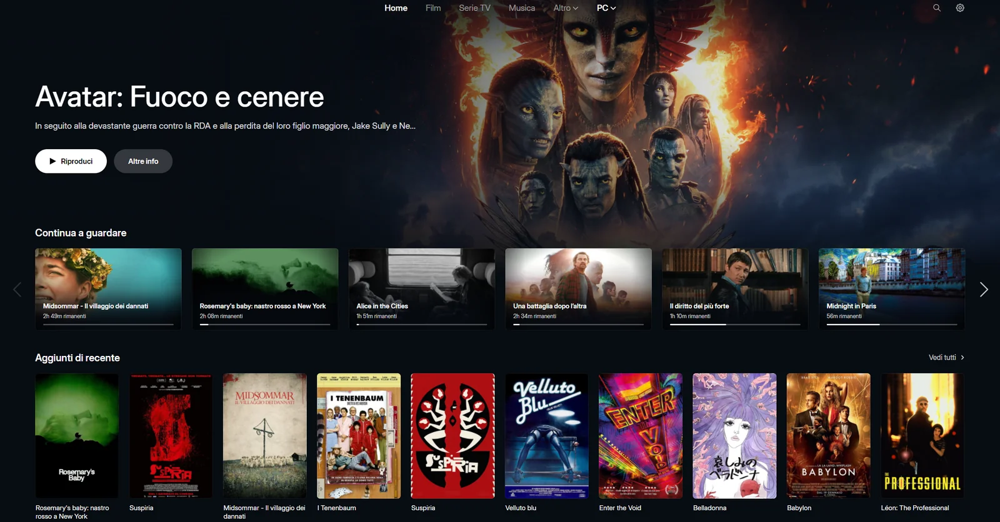<br>
  <sub>Home: rotating hero, Continue watching and Recently added</sub>
</p>

[](LICENSE)
[-0078D6?logo=windows&logoColor=white)](https://github.com/CinecorePlayer/CinecorePlayer/releases)
[-000000?logo=apple&logoColor=white)](https://github.com/CinecorePlayer/CinecorePlayer/releases)
[](https://dotnet.microsoft.com/)
[](https://avaloniaui.net/)
[](#-known-limitations)
[](#-system-integration)
[](https://github.com/CinecorePlayer/CinecorePlayer/releases)
[](https://github.com/CinecorePlayer/CinecorePlayer)

Built in C# / .NET 9 with one shared Avalonia interface on both systems. Free, no ads, no account, no telemetry. Source-available, non-commercial ([license](#-license)).

> **Status: beta.** Everything below works in everyday use, but it needs more testing on other GPUs, displays, audio devices and networks, and parts of the interface may still change.

---

## Contents

- [Download](#-download)
- [Requirements](#-requirements)
- [Features](#-features)
  - [Video](#-video) · [Audio & subtitles](#-audio--subtitles) · [Music](#-music) · [Library & network](#-library--network) · [Remote & home cinema](#-remote--home-cinema) · [Photos](#-photos) · [System integration](#-system-integration)
- [Windows vs macOS](#-windows-vs-macos)
- [Known limitations](#-known-limitations)
- [Privacy & keys](#-privacy--keys)
- [How it works](#-how-it-works)
- [Building from source](#-building-from-source)
- [Bug reports](#-bug-reports--feedback)
- [Security](#-security)
- [License](#-license)

---

## 📥 Download

All builds are on the [Releases page](https://github.com/CinecorePlayer/CinecorePlayer/releases).

### Windows — Beta 4.1 (0.4.1)

Download `CinecorePlayer2026-Beta4.1-Windows-Setup.exe` from the release tagged `beta-v0.4.1-Avalonia-Windows` and run it. What's new is in the release notes.

- Includes the .NET runtime, libmpv, FFmpeg, yt-dlp, madVR, MPC Video Renderer, XySubFilter, libaacs and Rubber Band: nothing else to install first.
- Optional components, selectable one by one: LAV Filters, MPC Audio Decoder, MPC Audio Renderer (with their original installers).
- Installs over a previous version; uninstalling also unregisters the filters.
- Administrator approval is needed for Program Files and filter registration. Some bundled third-party installers are unsigned.
- Updates itself from GitHub, verifying the SHA-256 before installing (Beta 3 and later; older betas need one manual install).

### macOS — Beta 1.1 (0.1.1)

Download `CinecorePlayer2026-Mac-0.1.1-arm64.dmg` from the release tagged `beta-v0.1.1-Avalonia-MacOs` and move **Cinecore Player** to *Applications*. What's new is in the release notes. Each file has its SHA-256 in the release notes and in a `.sha256` file next to it; `CinecorePlayer-Mac-0.1.1-arm64.zip` is the same app, used by the built-in updater.

- **Not notarized:** the first time, right-click › *Open*, or allow it in *System Settings › Privacy & Security*.
- Everything for mpv, music, photos, streaming and discs is inside the app.
- **madVR / MPC Video Renderer** need the optional **Windows engine** (Wine for ARM64 + the renderers and filters). The app offers it the first time you pick one of those renderers: about 1.4 GB to download and about 1.6 GB installed, downloaded from the official sites, every file checked against a SHA-256 built into the app. Without it, everything plays with mpv.
- Updates itself from GitHub Releases, with SHA-256 check.

---

## 🖥️ Requirements

| | Windows | macOS |
|---|---|---|
| System | Windows 10 2004 or later / Windows 11, x64 | macOS 13 Ventura or later, **Apple Silicon** (M1+). Intel Macs not supported |
| Runtime | Included | Included |
| Disk | — | +1.6 GB for the optional Windows engine |
| Metadata | Your own free TMDb key | Your own free TMDb key |
| Protected Blu-rays | MakeMKV or your own `KEYDB.cfg` | MakeMKV or your own `KEYDB.cfg` |
| Lyrics sync (optional) | Python + faster-whisper | Python + faster-whisper |

Advanced video features depend on the renderer, the GPU and the display.

---

## ✨ Features

### 🎥 Video

**Three engines, chosen per film:**

| Engine | Best for |
|---|---|
| **madVR** | Maximum quality: NGU/Jinc scaling, HDR tone mapping and profiles, 3DLUT |
| **MPC Video Renderer** | Light and modern; stable in power-saving mode. On Windows: **RTX Video Super Resolution** and **RTX Video HDR** (NVIDIA RTX) |
| **mpv** | Universal, fastest to open, lowest power; used for YouTube and network streams |

Each engine has its own settings pages inside Cinecore (madVR, including *Performance* with the DXVA and 3DLUT trade-offs, MPC-VR, LAV, XySubFilter, mpv), so you never need the original control panels.

- **Renderer presets** (right-click › *Video › Presets*):
  - **Automatic** (default): picks the renderer settings for each film from the GPU, the file's resolution, bitrate and codec, the frame rate, the window size and Low Power Mode, and shows in grey what it chose
  - **Custom**: your own automations, e.g. *"film is 4K and the PC is on battery → madVR: High"*
  - Ready-made **Low, Medium, High, Ultra** and **DVD & low quality** for madVR, MPC-VR and mpv; picking one restarts the film from the same point and never touches your saved Settings
- **0 dropped frames at start and after seeking** with all three engines; if madVR keeps dropping frames on a GPU that's too weak, the player offers to switch to mpv or MPC-VR — never on its own
- **Formats:** MKV, MP4, M2TS, TS, MOV, AVI, WMV, WebM and everything LAV and mpv read; YouTube and other sites through yt-dlp, with a resolution limit from 144p to 8K
- **Refresh-rate switching** before the film starts, with exact rational rates (23.976 stays 23.976), also on projectors and external displays; restored on exit
- **HDR:** passthrough (EDR on Mac displays), HDR→SDR with shaders or a 3DLUT, madVR HDR profiles
- **3D:** Side-by-Side / Top-Bottom detected automatically; keep both eyes for a 3D projector or show one
- **Image sizing:** constant height, constant area or custom; real aspect ratio measured live (IMAX scenes expand), crop to 4:3 … 2.76
- **Discs:** DVD with real menus on every engine (also from the phone remote), Blu-ray / ISO main title, audio CDs; *Resume / Start over* like a disc player
- **Controls:** timeline with frame previews and chapters, fast scan ×0.5–×4, frame step (`,` `.`), volume above 100% (+12 dB) with per-film memory
- **Skip Intro / Next episode,** detected offline by comparing audio fingerprints across a season's episodes
- **Stream quality switch** for YouTube, DLNA and Jellyfin, reloaded in place from the same point
- **Info panel:** source, decoder, live video/audio bitrate (also YouTube and DLNA), dropped frames
- **HDR analysis:** declared metadata (mastering, MaxCLL/MaxFALL, Dolby Vision, HDR10+), full-film measurement (peak/average nits, percentiles, Rec.709/P3/BT.2020 gamut), live scopes at 24 measurements/s on Windows (waveform, vectorscope, CIE 1931, false colour); export to HTML, PNG, CSV, JSON

<p align="center">
  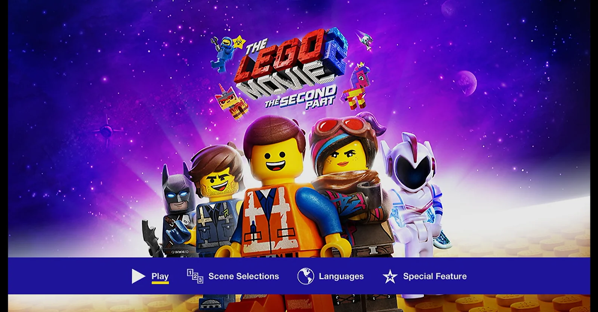<br>
  <sub>A DVD playing with its own original menu (The LEGO Movie 2)</sub>
</p>

<p align="center">
  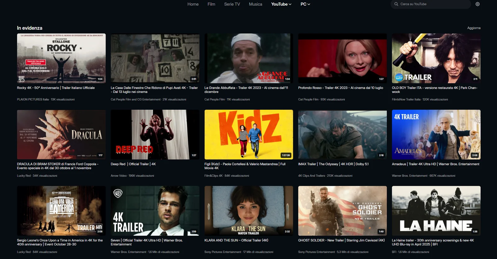<br>
  <sub>YouTube inside the player, with trailers and quality selection</sub>
</p>

<p align="center">
  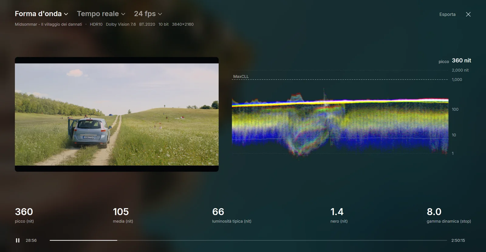<br>
  <sub>HDR analysis: live waveform of a Dolby Vision / HDR10 4K film, with peak, average, black level and dynamic range</sub>
</p>

### 🔊 Audio & subtitles

- **Bitstream** chosen track by track (details per platform in [Windows vs macOS](#-windows-vs-macos)); output device or *Auto / Force PCM* can change mid-film without restarting the video. On Windows, **MPC Audio Renderer** is used when installed, with automatic bitstreaming
- **Audio delay** on the fly (`Ctrl ±`), saved per film; fixed or **curved** delay for rips that drift
- **Automatic alignment** of an external audio track (e.g. a dub from another source), with 24 / 23.976 / 25 fps speed conversion
- **macOS spatial audio for headphones and Mac speakers:** 5.1 and 7.1 film tracks go through Apple's spatializer instead of being downmixed to stereo. Supported AirPods can use head tracking. Works with all three video engines; madVR and MPC-VR send audio through native mpv. DTS:X is rendered in 7.1.4, and TrueHD Atmos objects are positioned in 7.1.4. This applies to headphone and Mac-speaker playback; audio through an AV receiver is unchanged.
- **Network AV receiver control:** Denon/Marantz, Yamaha MusicCast, Onkyo/Integra/Pioneer, NAD, Anthem, UPnP. Hard-coded safety rules: reads the volume before each change, max +3 dB per step, ceiling at −20 dB, a film can only *lower* the volume at start
- **Subtitles:** internal and external, forced-only, full ASS/SSA through XySubFilter; search and download (OpenSubtitles, Subdl, YIFY, Addic7ed; 34 languages); **automatic re-timing** by listening to the film's audio

### 🎵 Music

The **Cinecore Audio Engine**: FFmpeg decoding, double-precision DSP, output through WASAPI (Windows) or Core Audio (Mac), shared, **exclusive or bit-perfect**.

- **DSP:** 10/31-band or parametric EQ with a graph editor, ReplayGain (track/album), crossfeed, stereo width, balance, mono, loudness compensation / dynamic AutoEQ, true-peak limiter
- **Gapless** (also in exclusive mode) and **crossfade** (3/6/10 s, skipped between tracks of the same album)
- **Automix:** beat grids, phrase boundaries, key and vocal activity pick the cue points and the transition; tempo matched with Rubber Band without changing pitch, then eased back. A **Crossfade only** style, and no club effects (echo, tape stop) on soundtracks, piano and music that isn't for dancing. *Sort queue for mix* by tempo, key and energy
- **Manual mix editor:** both waveforms with beat markers, cue points, tempo and effects; **draw the volume, filter and effect curves by hand**; the incoming track follows the outgoing tempo so beats stay locked. A saved transition is reused every time those two tracks play in that order
- **Radio:** when the queue ends, it continues with similar tracks from *your* library — offline, no external service
- **Lyrics:** LRCLIB, Genius, lyrics.ovh; unsynced lyrics aligned to the vocals with faster-whisper. If Genius asks for a check, *Tools › Genius: verify connection…* opens a window for it, and it stays valid across restarts
- **Library:** rotating artist banner, Continue listening, artist photos and covers (Spotify, TIDAL, Deezer), `.wpl` playlists, audio CDs via MusicBrainz
- **Meters:** spectrum, spectrogram, waveform, LUFS, stereo, levels and VU with PEAK/CLIP; true peak measured over the whole track, with steadier readouts
- Full-screen track view, **mini player**, Last.fm and ListenBrainz scrobbling (queued offline)

<p align="center">
  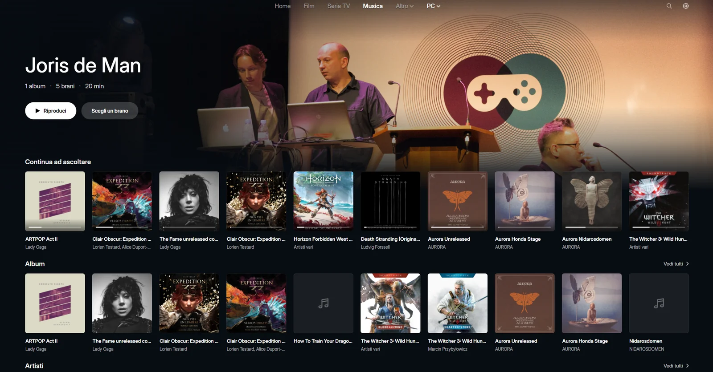<br>
  <sub>Music home: artist banner, Continue listening and albums</sub>
</p>

<p align="center">
  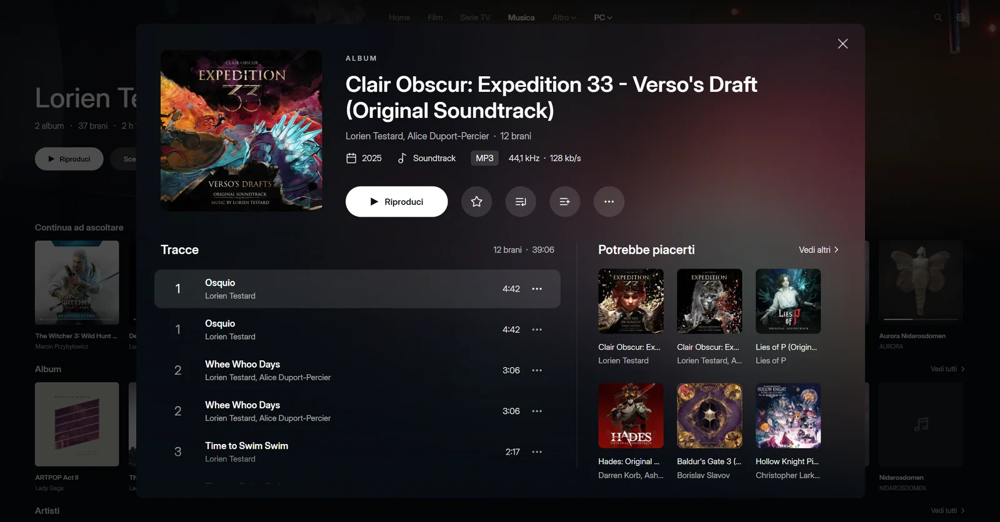<br>
  <sub>Album page with track list and suggestions (Clair Obscur: Expedition 33 OST)</sub>
</p>

<p align="center">
  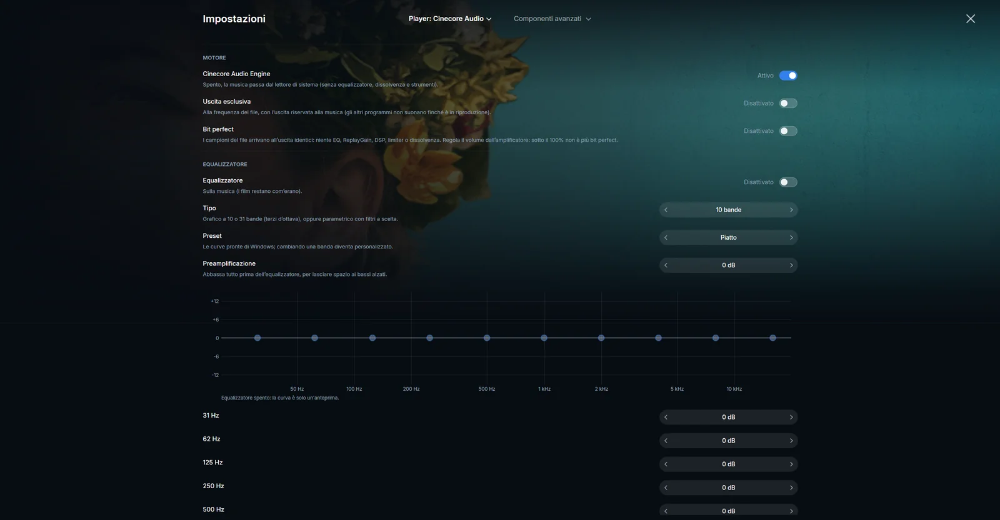<br>
  <sub>Cinecore Audio Engine settings: exclusive output, bit perfect and the 10-band equalizer</sub>
</p>

<p align="center">
  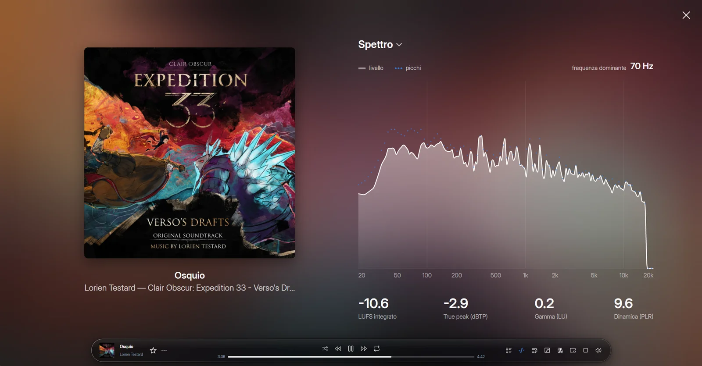<br>
  <sub>Full-screen track view with the live spectrum and loudness meters (LUFS, true peak, PLR)</sub>
</p>

### 📚 Library & network

- **Sections:** Home (rotating hero), Movies, TV Series, Music, Photos, Videos, Playlists, Network, Favourites, Diary; global search
- **TMDb metadata** in the app's language (English, Italian, Spanish): posters, backdrops, plots, cast, episodes; changing language updates titles and plots without losing covers or manual fixes; manual *Fix title and cover*
- **Title pages:** overview, file technical details, reviews and ratings (TMDb, IMDb, Letterboxd, Metacritic), cast
- **Filters and collections** by genre, year, decade, director, artist, folder; quick picks (Lossless, Atmos, Rated)
- **Library report:** duplicates, low bitrate, inconsistent HDR metadata, broken files
- **Spotlight:** full-screen discovery view, usable from the remote; **Cinema Mode** pre-film screen with optional demo clip
- **Network sources:** native **Jellyfin** (incl. Quick Connect) and **Emby** clients with server-side transcoding and synced progress; DLNA/UPnP (Plex included); network and rclone drives handled gently
- **Trakt:** personal recommendations (*Mark as watched*, *Not interested*), history and ratings sync

<p align="center">
  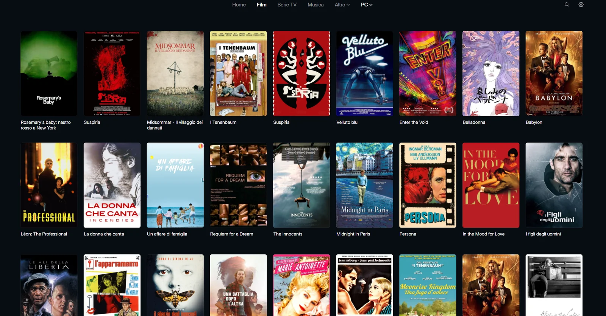<br>
  <sub>Movies: the full poster grid of the library</sub>
</p>

<p align="center">
  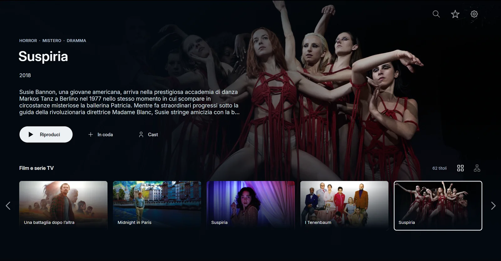<br>
  <sub>Spotlight: full-screen discovery view, usable from the remote</sub>
</p>

<p align="center">
  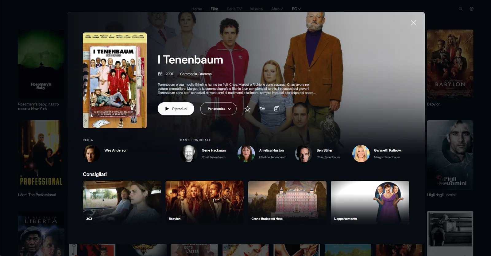<br>
  <sub>Title page: plot, director, cast and recommendations (The Royal Tenenbaums)</sub>
</p>

<p align="center">
  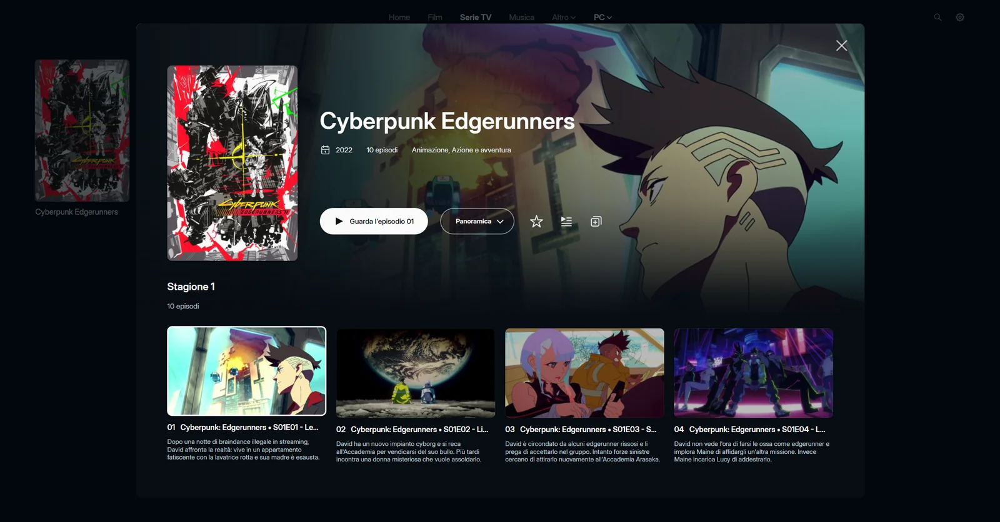<br>
  <sub>TV series page with seasons and episodes (Cyberpunk: Edgerunners)</sub>
</p>

<p align="center">
  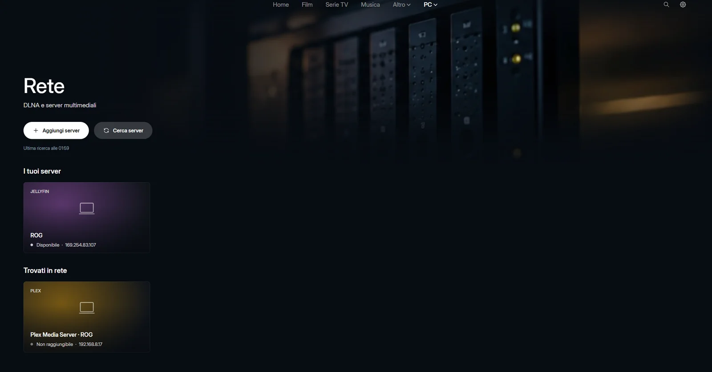<br>
  <sub>Network: your Jellyfin / Emby / DLNA servers and the ones found on the LAN</sub>
</p>

### 📱 Remote & home cinema

- **Phone remote** served by the player as a web page — no app to install. Pair with a QR code and PIN
- Playback, scan, chapters, volume, D-pad (also DVD menus), keyboard, tracks, library, queue and playlists
- **Trackpad mode** with inertial two-finger scrolling
- **Player settings from the phone** — the same catalogue as the desktop settings
- **This computer:** live CPU, memory, GPU, disks, network, battery
- **WLED** room lights that dim during the film
- **Home automations:** HTTP (GET/POST) or MQTT on start, pause, resume, stop and end credits (e.g. Home Assistant). Events follow the session, so lights don't flicker between songs

<p align="center">
  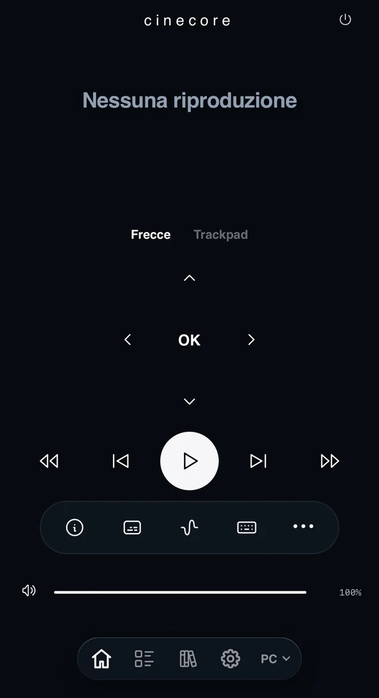<br>
  <sub>The phone remote: D-pad, playback, tracks and volume — no app to install</sub>
</p>

### 🖼️ Photos

Viewer with filmstrip, zoom, Info panel (camera, exposure, place in Maps) and slideshow; editor with adjustments, filters, crop and drawing — it always saves a copy, never changes the original. Share, copy, open with, print, set as desktop picture, move to Trash / Recycle Bin.

<p align="center">
  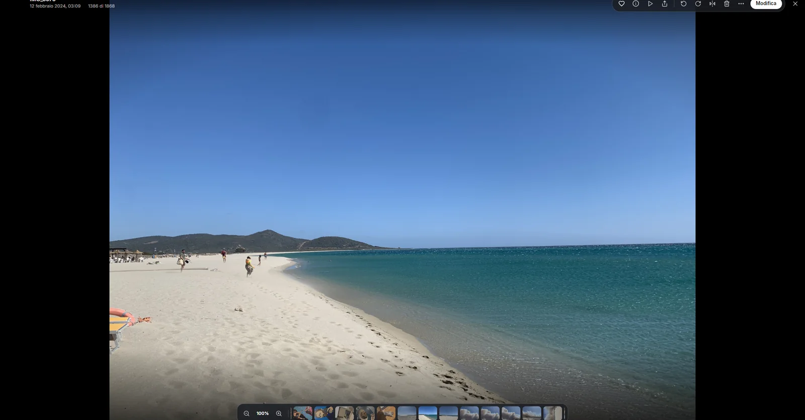<br>
  <sub>Photo viewer with the filmstrip and glass controls</sub>
</p>

### 🧩 System integration

- Light, dark or system theme, accent colour (picker with typed or pasted hex code); **English, Italian, Spanish**, translated down to menus and track names
- Media keys and system *Now Playing* / SMTC, Share sheet, *Open with* (files open straight away, without the startup screen), drag and drop, single instance
- **Power saving:** in Low Power Mode / Battery Saver the player offers a lighter renderer than madVR for the session (or *Don't show again*) — it never switches on its own; with a preset active, the presets handle it
- **Light on resources:** about 2.4% CPU at idle on Windows; the interface only redraws what changes
- **Shortcuts:** `Space` play/pause · `←` `→` ±10 s · `,` `.` frame step · `↑` `↓` volume · `F` fullscreen · `Z` sizing · `Ctrl ±` audio delay · `S` back to library · `Esc` back

<p align="center">
  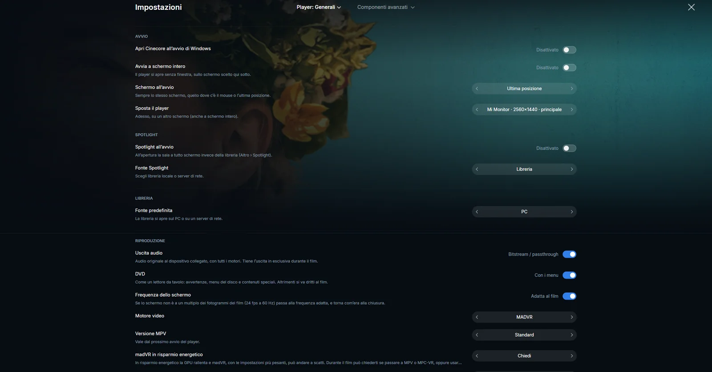<br>
  <sub>Settings: player, video engines and components in one place</sub>
</p>

---

## ⚖️ Windows vs macOS

Same interface and features; these are the differences.

| | Windows | macOS |
|---|---|---|
| mpv | Native, NVDEC on NVIDIA | Native, VideoToolbox decoding |
| madVR / MPC-VR | Native (DirectShow) | Through the optional Wine ARM64 engine, presented on Metal at the display's vsync |
| RTX Video Super Resolution / HDR | ✅ (MPC-VR, NVIDIA RTX) | ❌ |
| Bitstream: Dolby Digital / DD+ (Atmos), DTS core | ✅ | ✅ |
| Bitstream: TrueHD, DTS-HD MA, DTS:X | ✅ | TrueHD only with an HDMI adapter carrying HBR; DTS-HD MA / DTS:X decoded to multichannel PCM |
| Music output | WASAPI shared / exclusive | Core Audio shared / exclusive (hog mode) |
| Picture in Picture | Music mini player only | Music mini player only |
| Glass | Windows acrylic / DWM (also live in the music bar, Photos and menus) | **Liquid Glass** on macOS 26+, real blur on earlier versions |
| Remote address | Also a `….local` name, no port needed | IP + port 9234 |

---

## ⚠️ Known limitations

**Both platforms**
- No Blu-ray menus; decryption of protected Blu-rays never tested on a real disc; UHD needs MakeMKV
- HDR analysis is an estimate from sampled frames; Dolby Vision profile 5 can't be measured
- Automix and audio alignment are new and can miss on difficult tracks; receiver control verified on a Marantz only
- Jellyfin tested with 10.11, Emby with 4.10; DLNA depends on the server
- Subtitles, ratings, metadata and lyrics depend on third-party services
- Lyrics sync needs Python with faster-whisper installed separately
- No video Picture in Picture (removed: it froze with madVR); the music mini player stays

**Windows**
- A 4K YouTube video still takes 20–25 s to open (about half is yt-dlp)
- With madVR the screen can go black for a moment while the renderer initialises
- The *Automatic* preset is tuned on a small set of measurements (RTX 3080): on very different GPUs it may be too cautious or too heavy. Use *Custom* or pick a preset by hand, and please share the `[preset] automatico: …` log lines

**macOS**
- The *Automatic* preset is tuned on an M4 MacBook Air: Low Power Mode limits are measured, full-power limits are estimates. Other Macs may get a level that is too cautious or too heavy; please share the `[preset] automatico: …` log lines
- Apple Silicon only; not notarized (ad-hoc signed)
- madVR / MPC-VR under Wine use more energy than mpv
- In Low Power Mode, madVR's heaviest presets can't keep up on 4K 16:9 films; the player offers MPC-VR or mpv
- madVR ignores 3D sources (mpv and MPC-VR handle them)
- Blu-ray playback not yet tested on a real disc
- Live HDR scopes reach about 13–15 measurements/s instead of 24
- The remote's trackpad needs the Accessibility permission, which macOS may ask for again after an update

---

## 🔒 Privacy & keys

- **No telemetry.** Outgoing connections only go to services you use (metadata, subtitles, lyrics, YouTube, Trakt, Last.fm, updates).
- **Your keys** (TMDb, OpenSubtitles, Subdl, Spotify, TIDAL) and accounts (Trakt, Last.fm, ListenBrainz, Jellyfin, Emby) are typed once in the settings and stored **encrypted** (Windows DPAPI; an encrypted local store on the Mac). Never in clear text, never in logs.
- Only the application's own Trakt and Last.fm registrations are built in; they are not in the public source.
- Subtitle search sends only titles and public IDs, never file names or paths.
- The remote only accepts paired devices; wrong PINs are throttled.

| Data | Windows | macOS |
|---|---|---|
| Settings, library, playlists | `%APPDATA%\Cinecore` | `~/Library/Application Support/Cinecore` (settings), `~/Library/Application Support/CinecorePlayer2025` (library, playlists, history) |
| Cache and logs | `%LOCALAPPDATA%\Cinecore` | `~/Library/Application Support/Cinecore` (cache), `~/Library/Logs/Cinecore` (logs) |
| Windows engine | — | `…/Cinecore/engine` |

---

## 🔧 How it works

- **One codebase, two systems.** The app lives in `mac-native/CinecoreMac`; the Windows project compiles the same sources with `CINECORE_WINDOWS` and swaps a few `Platform/*.Win.cs` files (windows, audio output, secrets, refresh rate, media keys).
- **Video in its own window, under the UI.** madVR and MPC-VR keep their own window and Direct3D; the transparent Avalonia window sits on top with HUD and menus, so opening a menu never makes the film stutter.
- **VideoHost**, a separate process, builds the DirectShow graph (LAV → madVR / MPC-VR + XySubFilter) and takes text commands on stdin. A renderer crash never takes the player down — and it is the same program that runs under Wine on the Mac. On Windows a film starts with madVR in about 5.5 s, and renderer settings are written only when they change.
- **On the Mac,** VideoHost runs in Wine 6.0 ARM64 with FEX; decoding goes through a VideoToolbox bridge (≈70% CPU vs 227% in software), madVR's D3D9 frames are carried to D3D11 and presented on Metal via DXMT, and patched winemac/wined3d lock presentation to the display link (3:2 cadence at 24 Hz with 0 drops).
- **Hand-drawn UI** on Avalonia/SkiaSharp, with an in-frame glass blur; pages redraw only when something changes (hover, playback, data); ReadyToRun compilation on Windows to avoid JIT stutter.

---

## 🛠️ Building from source

Requires the **.NET 9 SDK**.

**Windows**

```powershell
cd win-native/CinecoreWin
dotnet build                      # VideoHost and IntroOutroDetector build alongside
dotnet publish -c Release         # ReadyToRun; copies third-parties into the package
```

Installer: **Inno Setup**, then `installer/Build-Installer-Avalonia.ps1`. Version and file name come from `<Version>` and `<InformationalVersion>` in `CinecoreWin.csproj`.

**macOS (Apple Silicon)**

```bash
dotnet build mac-native/CinecoreMac/CinecoreMac.csproj -c Release
bash mac/build-native-app.sh      # .app with libmpv, FFmpeg and native libraries, ad-hoc signed
bash mac/make-mac-release.sh      # DMG + update zip, .sha256 files, SHA-256 in the release notes
```

The application keys for Trakt and Last.fm are not in the repository: add your own in `SecretVault.Keys.cs`.

---

## 🧪 Bug reports & feedback

Open an [Issue](https://github.com/CinecorePlayer/CinecorePlayer/issues). For playback problems, please include:

- Windows / macOS version (and Mac model)
- GPU and renderer, and the active preset (shown in grey in *Video › Presets*)
- Audio output mode (shared, exclusive, bitstream) and device
- File format and resolution
- Exact steps to reproduce
- The latest `app-*.log` (Windows: `%LOCALAPPDATA%\Cinecore\Logs`; macOS: `~/Library/Logs/Cinecore`)

Remove personal paths, tokens and credentials from logs before posting.

---

## 🛡️ Security

Please **don't** report vulnerabilities in public issues. Use the repository's *Security › Report a vulnerability* page; see [`SECURITY.md`](SECURITY.md) for supported versions, scope and response times.

---

## 📄 License

Cinecore Player's original code is released under the **[PolyForm Noncommercial 1.0.0](LICENSE)** license: you may use, study and modify it for non-commercial purposes; commercial use is not permitted. It is source-available, not OSI open source.

Third-party components keep their own licenses: FFmpeg, libmpv and MPC Video Renderer (GPL); libaacs, libbdplus and Wine (LGPL); Lucide icons (ISC); Inter (SIL OFL). See [`THIRD-PARTY-CREDITS.md`](THIRD-PARTY-CREDITS.md).

---

If you like Cinecore Player, a ⭐ on the repository helps others find it.

